# COMP 3710 Assignment 3 README
### Dan Fuller, Student number: 48841988

## Feasibility Checkoff

markdown version:

**Feasibility Check-Off: VQ-VAE**  
Daniel Fuller: 48841988 

**1\. User Need, Scope and Acceptance Criteria**   
**User Need**: Researchers and clinicians working with prostate MRI data cannot use real patient data because of privacy laws. Realistic generated scans would provide resources for medical research without compromising real people’s privacy.  
**Scope / Purpose**: 2D slices, VQ-VAE vs a VAE baseline, SSIM evaluation, monitoring, generation of prostate scans. The point is to show if a VQ-VAE can compress 2D HipMRI slices into a discrete set of codebook entries which can be used to generate new images. This can be compared in diversity, memorisation, and fidelity to a VAE using a continuous kl regularised latent.   
**Acceptance Criteria**: 

- Mean reconstruction SSIM \> 0.6 on test set.   
- SSIM specifically within the prostate area increases compared to the baseline.   
- No codebook collapse, check that most entries within the dataset are used.   
- Affordable training process, measured with job time and max memory allocated in RANGPUR.   
- Successful patient level split, measured with a pre-train search of datasets.    
- Generated samples are no closer to their nearest training slice than test slices are, measured by SSIM. This ensures the model is not just memorising.   
- Pairwise distance across generated samples is reported, and no mode collapse is visible in an uncurated grid. 

**2\. Model Choice and Course Concepts**   
**Dataset configuration**: HipMRI 2D slices (keras\_slices\_data), loaded from NiFTI, pre split into training, validation, and test sets. Images will be normalised to greyscale \[0,1\] and padded to ensure compression works.   
**Baseline**: Standard VAE trains on the HipMRI data. Compression to \[32x16\] and decoding back to \[256 x 128\]. VAE uses continuous latent values. Is able to generate new images using samples from the latent space.   
**Model**: Convolutional encoder to \[32x16\] latent grid, vector quantiser with a defined codebook of vectors, and a mirrored decoder. Training uses reconstruction loss plus codebook and commitment losses, with straight-through gradient estimation. EMA codebook updates are the planned default for stability. Discrete codebook entries. Generates new images using a second stage autoregressive prior over the code grid which is trained after the VQ-VAE.   
**Difficulty Band**: Hard   
**Course Concepts / Literature**: Reference \[12\] from the task sheet: “Neural discrete representation learning”. Applied course concepts: convolutional layers, autoencoders / bottlenecks, separation of encoding and decoding to create generation, parameter updating using backpropagation. 

**3\. Preliminary Feasibility Evidence**   
**Data Structure**: Already pre-split into test, train, and validate data sets, with segmentation masks defining the prostate area. No overlap between sets:  

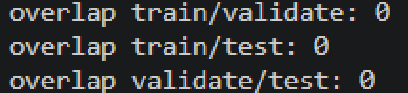 
**Baseline Smoke Test**: (generated samples are still essentially noise, but it’s a smoke test)  

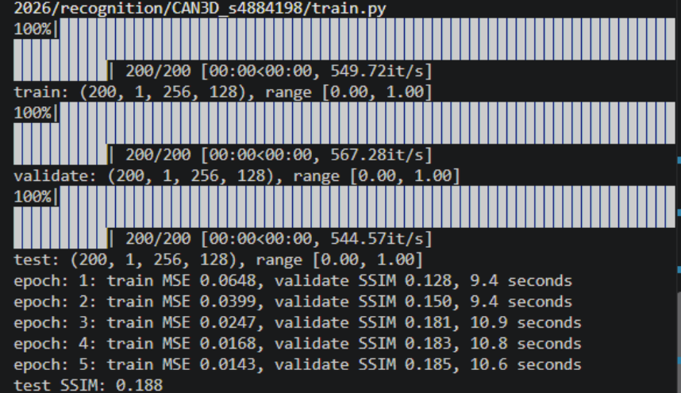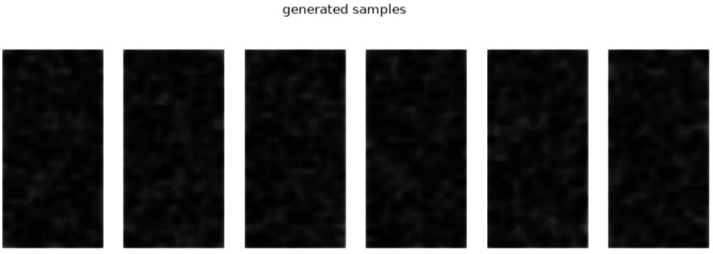

**4\. Risks, Budget and Fallback**   
**Risks**: The risks associated with the VQ-VAE include: codebook collapse, slice level leakage inflating SSIM, SSIM reaching the threshold of 0.6 but images still being blurry, memorisation, and prior failing.   
**Computing Budget**: Roughly 8 hours on the RANGPUR COMP3710 cluster.   
**Next Planned Experiment**: Training the full VQ-VAE (with prior) and baseline on the same split and comparing SSIM, codebook perplexity and visual generations. Also, nearest neighbour checking to validate memorisation.   
**Fallback**: Raise latent resolution or codebook size first, then add an SSIM loss term. If prior is not working, use a smaller codebook and simpler autoregressive model. 

pdf version (converted into image):

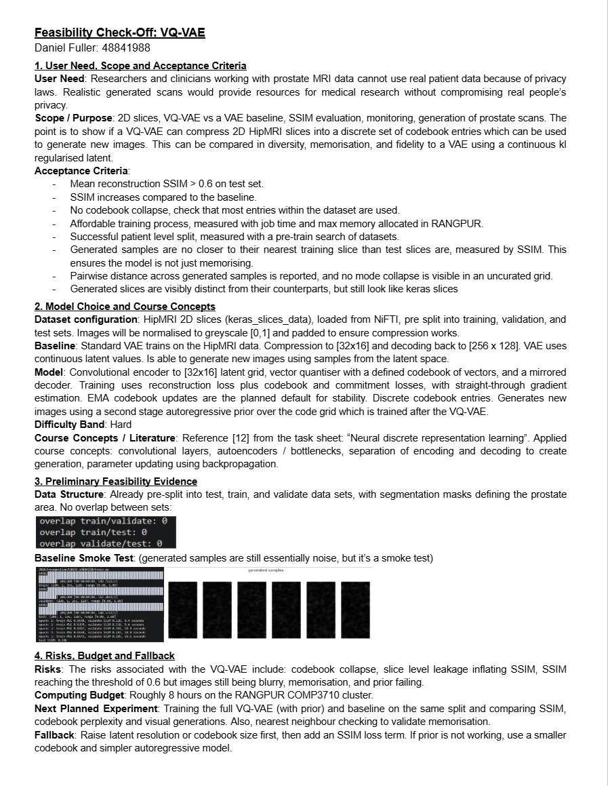

# Files

## modules.py 
Contains all model components. Written with pytorch. 

- Encoder: three stride-2 convolutions shrink an image of dimensions (1, 256, 128) to a latent grid of dimensions (D, 32, 16)
- Decoder: the reverse of the encoder. Using transposed convolutions and a sigmoid at the end so pixel values are between 0 and 1 

- BaseModel: plain autoencoder with a continuous latent. Used for a smoke test before creating the VAE
- BaseVAE: the baseline model for this assignment. The encoder outputs a mean and logvar per latent value, a sample is drawn with the reparamatisation trick, and a KL term i have denoted as beta pulls the latent towards N(0, 1). Image generation works by decoding random latents.

**MAIN MODEL COMPONENTS**
- VectorQuantizerEMA: replaces each of the 32 x 16 encoder vectors with its nearest entry in the codebook (512 learned entries of dimension 64). The codebook is updated with exponential moving avg, and unused entries are reseeded from encoder outputs to avoid codebook collapse (which is when a small amount of codebook entries are the only ones which ever get used). A commitment loss keeps encoder outputs close to their codes, and gradients pass through the snapping step with the straight-through estimator.
- VQVAE: encoder, quantiser and decoder in sequence. The encoder is deterministic and doesnt have a KL term, unlike BaseVAE. It can reconstruct images, but can't generate. 
- CodePrior: a small casual transformer over the 512 code indices of a grid in raster order. It is trained with cross entropy loss to predict each code from the ones before it. For generation, it samples a code grid one token at a time (with a temperature setting), and the VQ-VAE decoder turns it into an image.

**Usage of these models are throughout train.py and predict.py**


## dataset.py 
Loads and preprocesses HipMRI 2d slices (keras_slice_data) and returns usable pytorch data loaders
- load_slices: reads the nifti files with nibabel, drops any extra dimensions (as a safety feature I'm pretty sure this is overkill), and converts to fload32. Slices which aren't 256 x 128 are resized to fit the proper size, as this is what the encoders expect (this cost me an overnight RANGPUR run before I realised some were odd sizes). Each image is then min-max scaled to [0, 1]. Masks are binarised (>0) 
- pad_multiple: pads height and width to a multiple of 8 so the encoder's 3 stride-2 layers divide evenly. This is also overkill as everything is generally 256 x 128, but good as safety.
- DatasetSlice: a Dataset wrapper which returns an image, or an image mask pair when masks are loaded
- get_dataloaders: builds the train, validate, and test loaders (batch size 64, shuffled for training). It also takes a subset parameter for quick / cpu based tests and a with_masks parameter for masks 
- check_no_overlap: extracts patient IDs from the filenames with a regular expression and reports slice counts, ID counts and the overlap betwenn each pair of splits. This is mainly just to fulfil a success criteria I made in the checkin. 

For data splits I use the given ones in the task. check_no_overlap never found any overlap between them.

DATA AUDIT FINDING: There were 60 out of the 11,460 training slices which were 256 x 144. Validation and test slices were uniform. Slight horizontal squashes were applied to the misshapen files. 

**Usage of this file is to provide data to train.py**


## predict.py 
Loads saved pth files and generates results without retraining. This is a command line based file   

- load_model: builds the chosen model from .pth, this must be run from the same folder where the relevant .pth is stored.
- reconstruct: reconstructs the whole test split, prints mean, min and max SSIM, and saves a figure of evenly spaced slices with an abs error heatmap 
- generate_vae: saves a grid of samples with fixed seed for reproducability 
- generate_vqvae: saves a grid of samples with fixed seed for reproducability
- GRID and checkpoint names are also defined in this file 


**usage:**

predict.py recon vae            <--- reconstruct test slices (original / reconstruction / err)

predict.py recon vqcae          <--- same deal

predict.py generate vae [match]   <--- sample from the VAE latent

predict.py generate vqvae <--- sample code grids from the prior then decode, default temperature 1.0


## train.py 

This is the meat and bones. It contains the training loops for all models and the evaluation code that produces the results table. I considered putting the evaluation code in predict.py but the task sheet stated "code for training, **validating, testing**, and saving" so I put it here

TRAINING 

- main(model, ckpt_path): the shared loop for the autoencoder, VAE and VQ-VAE. It uses the Adam optimiser, a loss of MSE plus the model's extra loss, which for the BaseVAE is the KL term and for the VQVAE it's the commitment loss. Currently, the batch size is set to 64, and 80 epochs. 
- train_basemodel, train_vae, train_vq_vae: all just wrappers that build a model and call main
- train_prior: freezes the trained VQVAE, encodes every training and validation image into its 32x16 grid of code indices, and trains the transformer prior with cross entropy (Adam, gradient clipping at 1.0). It keeps the checkpoint with the lowest validation loss, then samples images with a fixed seed


EVALUATION

- recon_ssim: SSIM and MSE between each unseen test slice and its own reconstruction. This is the metric for the SSIM > 0.6 target 
- codebook_usage: how many of the 512 codes are used on the test set, and the perplexity
- sample: generates images (the prior then teh decoder for the VQVAE and random latents for the VAE, with fixed seeds)
- fid_score: Fréchet Inception Distance between generated samples and the test set, using the standard pretrained Inception network only as a feature extractor. I beleive this is allowed as per an ed discussion post I saw
- nearest_ssim: memorisation detection. Each generated image is compared with every training slice to find its nearest one, and the result is compared with how close unseen test slices get to the training set. This is used only to detect near-copies. It isn't a quality score 
- mean_pairwise_ssim: diversity statistic comparing generated samples with real slices
- interpolate: latenet space interpolation between pairs of real training slices
- run: evaluates one model and saves figures and a results_[model].json and [table], printing all results side by side. 

**Usage.** 
edit the ```__main__``` block at the bottom of the file to choose the operation 
```
# training the vae
WARMUP = 15
train_vae()

#training the VQVAE 
WARMUP = 0
train_vq_vae()
train_prior() #this needs vqvae_best.pth to be saved

#evaluating the models
run("vae")
run("vqvae", temperature=1.0)
table()

```

## curves.py 
helper function solely to generate training curves from RANGPUR .out files. This is another command line based file. 

- parse(path, pattern): reads a log file line by line and keeps only the lines matching the given regular expression. Each match yields epoch, value_a and value_b, which is train MSE, validation SSIM for autoencoder logs and train CE, validation CE for prior logs. It returns a list of runs. A new run starts whenever the epoch number doesnt increase. This lets several training runs in one log file be separated.  
- plot_ae(items): draws the autoencoder figure from a list of (label, runs) pairs. The left panel plots training loss on a log scale and the right plots validation SSIM with a dashed line for 0.6 (the defined target). Each run is overlaid with its label in the legend and the fig is saved as ae_curves.png. 
- plot_prior(items): draws one panel per prior log, with training cross entropy as a solid line and validation cross entropy as a dashed line. It marks the lowest validation value with a black star, which is the epoch where the best prior checkpoint was saved. The fig is saved as prior_curves.png. 

**usage**
requires this command line structure:

```python plot_curves.py VAE=vae_full.out VQVAE=vqvae_full.out PRIOR=prior_full.out```


## general operational advice 
- ROOT global variables have to be changed to suit the user. For rangpur, use the RANGPUR root, and when running locally it has to be changed as well. 
- generally, these processes take forever, especially evaluation and training, when run on CPU power. Where possible use GPU clusters.
- before committing to a large run, decrease the epoch count heavily and run a smoke test to make sure files are in the right place. Set all epoch variables to like 2 or 5 or something.
- make sure to save outputs from previous runs in another folder, or rename them. The names of saved files are static, so generated files from new runs can override old ones. 

the following is the job.sh I used to run the training file on the GPU cluster, feel free to reuse:
```
#!/bin/bash
#SBATCH --job-name=evaluation_full
#SBATCH --partition=comp3710
#SBATCH --account=comp3710
#SBATCH --gres=gpu:1
#SBATCH --cpus-per-task=4
#SBATCH --time=02:00:00
#SBATCH --output=VQVAE_s4884198/evaluation_full_%j.out
#SBATCH --error=VQVAE_s4884198/evaluation_full_%j.err
# Activate your conda environment
source $HOME/miniconda3/bin/activate
conda activate torch
# Run the script
python VQVAE_s4884198/train.py
```


# Process / Adjustments
### baseline vae:
- during the smoke test for the checkup, I used a small subset of the data, unaware that some of the file sizes were different (256x144). This resulted in my first complete attempt to result in an error. This was fixed with a function running in the dataloader which normalises the images to 256x128
- in the second attempt, (running for 80 epochs) the vae showed a final SSIM of 0.952. The issue here was that the weak KL term meant the latent space didn’t match the N(0,1) used for sampling, so sampling landed where the decoder hadn’t been trained. The beta value I supplied in the KL calculation was too small (1e-3), and my vae essentially just became a regular autoencoder, so the randomly produced samples from the latent space were gibberish, just noise essentially, while the learned slices were accurately reconstructed: 

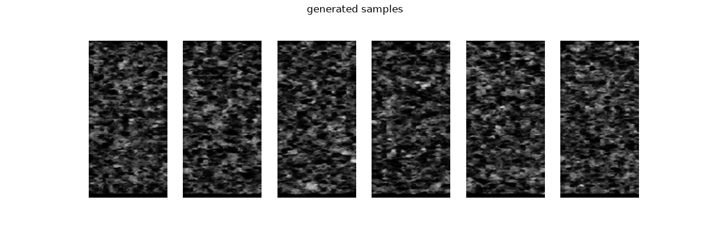
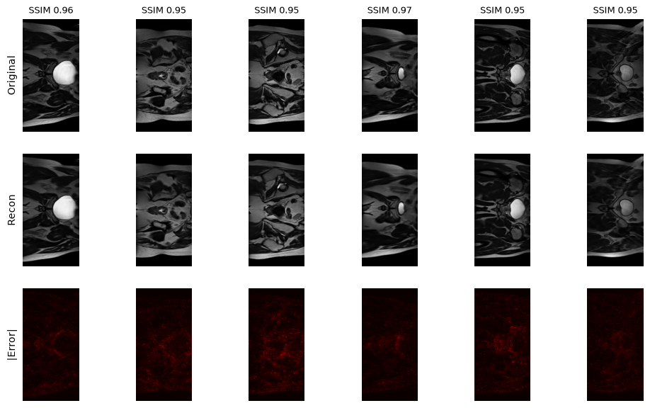

- increasing the beta (1e-1) and providing a warmup period for the vae decreased the specificity. In an effort to increase the fidelity of generated images, I also tried reducing the latent dimension of the trained vae. This reduced reconstruction fidelity and reduced the amount that the images looked like pure noise, but it was still unable to produce coherent generated images. 

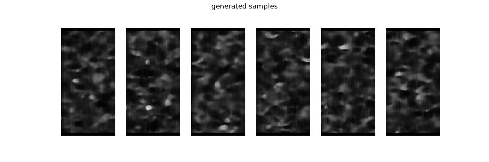
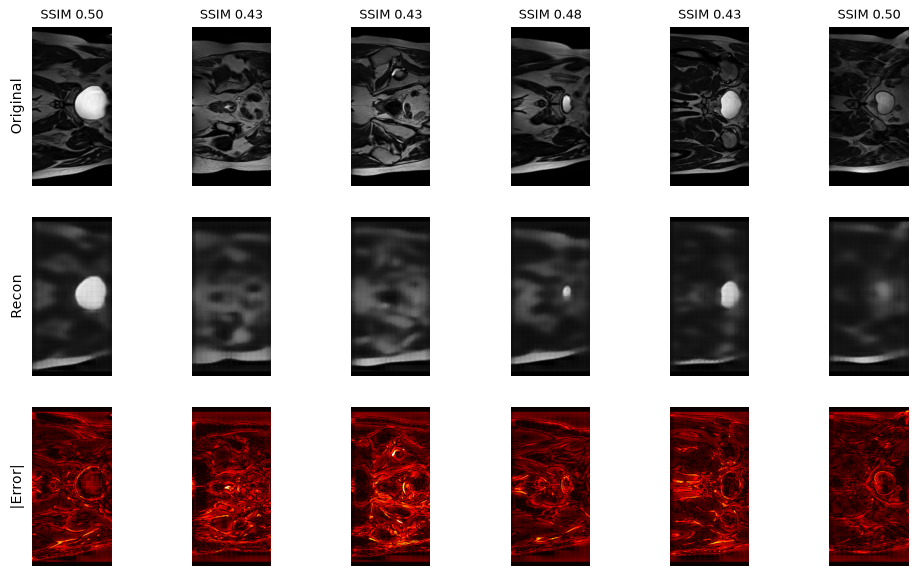


### vq vae 
- The vq-vae requires the training of 2 different models, the actual vector quantised autoencoder, and the prior (used for generation)
- Initial adjustments for data loading had to be made, but after that I ran the training process for 80 epochs on the autoencoder, and 30 epochs on the prior (which itself relies upon the pre-trained autoencoder) 
- In the results for this, the autoencoder was reporting SSIM close to 0.8, and did not appear to be making significant improvements to this metric, but the prior still looked like it was making progress judging from training loss. The final training CE for the prior was 3.625.
- For this reason, I retrained the prior with 60 epochs. The final stats were:

autoencoder:
```
epoch: 80: train MSE 0.0028, validate SSIM 0.778, 3.0 seconds
test SSIM: 0.806
peak VRAM: 0.82 GB
train: (11460, 1, 256, 128), range [0.00, 1.00]
validate: (660, 1, 256, 128), range [0.00, 1.00]
test: (540, 1, 256, 128), range [0.00, 1.00]
codes: train (11460, 512), val (660, 512), grid 32x16
```

prior:
```
epoch 60: train CE 3.474, val CE 3.972, 14.2s
peak VRAM: 2.85 GB
generation time for 16 images: 2.5s
```
- judging by the difference in training and validation CE, there may be some overfitting, but I would not say the model is memorising images. 
- the end of training generation produced these samples:

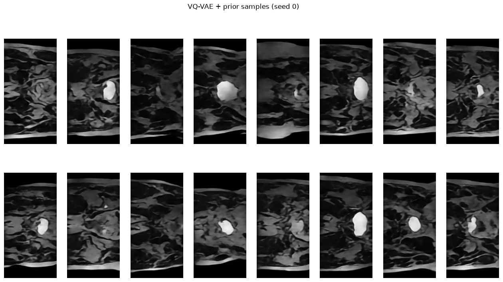


# evaluation 

The following are the statistics produced by the full evaluation stat dump after running the eval code on the RANGPUR GPU cluster:


| Model | VAE | VQ-VAE Temp 0.9 | VQ-VAE Temp 1.0 |
| -------- | -------- | -------- | -------- |
| n_gen  | 64 |  64| 64 |
| n_train_ref  | 11460 |11460  | 11460 |
| n_test_queries  |  200 | 200  | 200 |
| recon_ssim_test  |  0.4472905695438385 | 0.8055967688560486  | 0.8055967688560486 |
| recon_mse_test  |  0.006539395544677973 | 0.0018718757200986147  | 0.0018718757200986147 |
| codes_used |   |  512 | 512 |
| perplexity  |   |  334.1156311035156 | 334.1156311035156 |
| codebook_size  |   | 512  | 512 |
| gen_time_s | 0.019147872924804688  |  8.334158420562744 | 8.594757556915283 |
| gen_nn_ssim_mean  |  0.36210864782333374 | 0.4199681878089905  | 0.3917403817176819 |
| gen_nn_ssim_std |   0.014701646752655506 | 0.03443646803498268  |0.0425240732729435  |
| test_nn_ssim_mean |  0.36795321106910706 | 0.36795321106910706  |0.36795321106910706  |
| test_nn_ssim_std | 0.03222741186618805  |0.03222741186618805   |  0.03222741186618805 |
| test_nn_ssim_p95  | 0.43017399311065674   | 0.43017399311065674  |0.43017399311065674  |
| gen_frac_above_test_p95  |  0.0 |  0.390625 |0.171875  |
| gen_nn_ssim_max  | 0.3952794075012207  |  0.48835253715515137 | 0.48243677616119385 |
| pairwise_ssim_gen  | 0.39985397458076477  |  0.32045307755470276 |0.2945951521396637  |
| pairwise_ssim_real  |   0.25888755917549133 | 0.25888755917549133  | 0.25888755917549133 |
| fid  | 493.6816101074219  | 206.61737060546875  | 225.224609375 |
| fid_n  |500| 500 | 500 |


The three models run in the full evaluation are the baseline VAE, the VQ-VAE at a temp setting of 0.9, and the VQ-VAE at a temp setting of 1.0. The temp setting controls how random the prior's sampling is. Lower temperature picks likelier codes, so the samples are cleaner and more typical, but less varied. 

**Results interpretation**

- reconstruction: The VQVAE reaches a paired test SSIM of 0.806 (MSE 0.0019). This is above the 0.6 target. The baseline reaches 0.447 (MSE 0.0065). The VAE's KL tern trades reconstruction fidelity for a latent space which is better to sample from. 
- codebook health: all 512 codes are used on the test set, with a perplexity of 334. This implies that the codebook did not collapse, and the EMA updates and dead-code reset worked as intended. 
- generation quality: the VQVAE with prior has a much lower FID than the VAE (207 and 225 vs 494). Both VQVAE results are still high in absolute terms, FID was computed on only 500 samples, and the inception features are not trained on MRI. FID is therefore used only as a relative comparison and doesn't really show the samples anatomical accuracy.
- memorisation: No generated image is close to a copy of a training slice. The highest nearest neighbour image is 0.49 SSIM, which is far from being a duplicate, where you would expect the SSIM to be higher than 0.8. That being said, 17% in t=1.0 and 39% in t=0.9 of VQVAE samples sit above the 95th percentile of unseen test slices, when 5 is expected by nature. This means that generated images are somewhat closer to the training set than real unseen scans are. SSIM favours smoot, typical image generation, so this is consistent with drift towards typical anatomy rather than copying, but it is inconclusive. VAE scores 0 just because it's generally not producing accurate images. 
-  diversity: pairwise SSIM between VQVAE samples (0.295 at t=1.0 and 0.320 at t=0.9) is higher than between real slices (0.259), so samples are slightly less varied than real data but not collapsed. The VAE samples are the most similar to each other (0.4), which fits blurry, near identical outputs. 
- cost: generating 64 images takes 8.3 to 8.6 seconds for the VQVAE (512 sequential prior steps) vs 0.02 seconds for the VAE. Training memory was 0.82 gigs for the VQVAE and 2.85 gigs for the prior. 
- limitations: nearest neighbour SSIM only detects pixel level near copies, not shared anatomy / features. Quantitative metrics can't really establish clinical plausability. The prior shows some overfitting (train cross entropy 3.47 vs validation 3.97)
- temperature tradeoff: lowering the prior temperature from 1.0 to 0.9 improved the FID (207 vs 225) but reduced diversity and moved samples closer to the training set. The difference comes from 64 samples at one seed, so they are indicative and not statistically tested. 


**samples**

These are some randomly selected samples from the vqvae temp 1.0 generation:

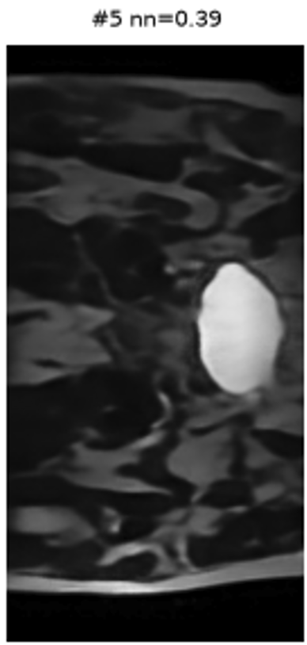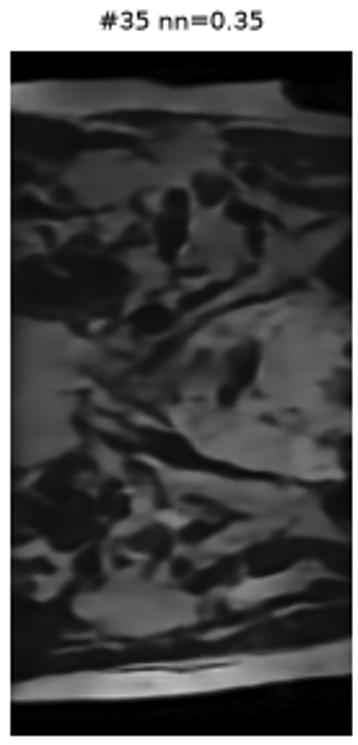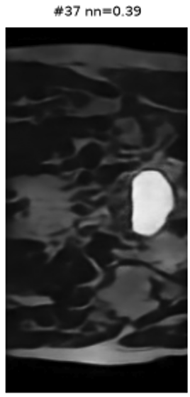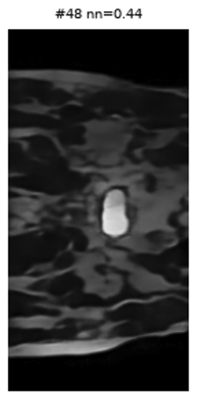


Obviously these images aren't perfect. All of them contain a degree of blur, and they are slightly too asymmetrical when compared to real human slices. There is a very slight noise seen in the backgrounds, particularly on the bottom side of the generated images. It seems that the noise likely points to the decoder, while the asymmetry likely points to the prior sampling codebook entries which don't perfectly fit together. Ultimately though, these do look like the keras slices in my opinion (which is by no means that of an expert, just basic observations).

Here's the generated nearest pairs:

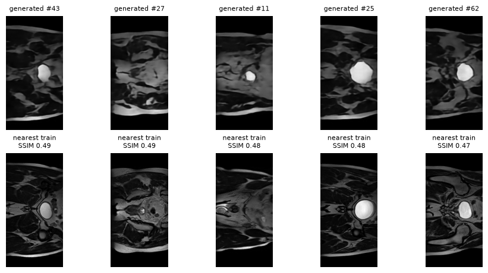

The VAE nearest pairs are not relevant, due to the flawed generation 

temp 1.0

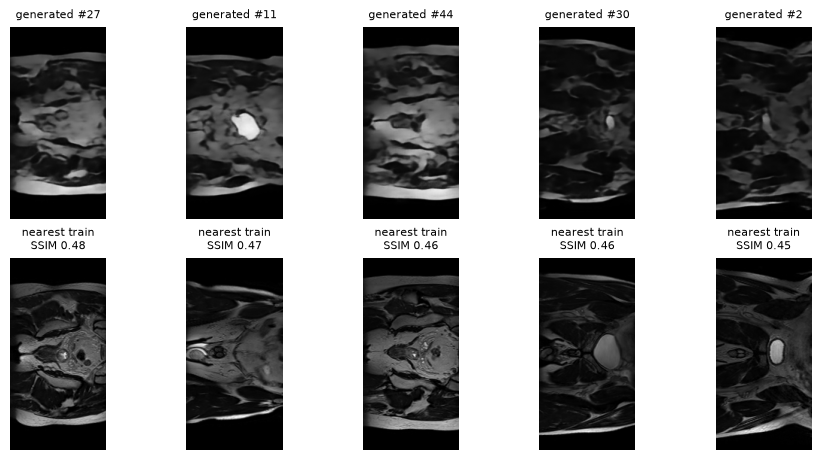

temp 0.9


As for the VQVAE nearest pairs. The temp 0.9 nearest pairs do look observably closer to their closest counterparts than the temp 1.0 ones, but while the temp 0.9 pairs do contain similarities in overall structure, I don't think it can be said they are copies. I beleive there is enough observable difference in both sets. The mean nearest neighbour SSIM for t=0.9 is 0.42, while it is 0.39 at t=1.0. This does show that t=0.9 is closer to it's nearest pair consistently. 


here's the interpolation figures between VAE and VQVAE:

vae:

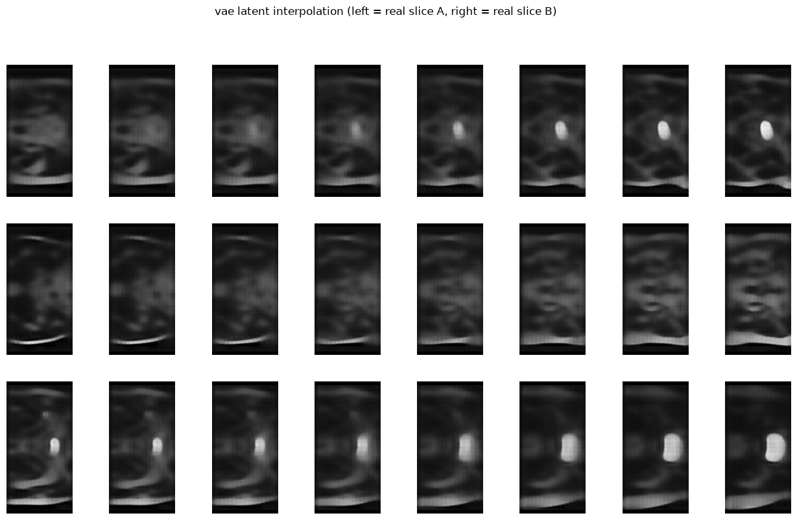


vqvae:

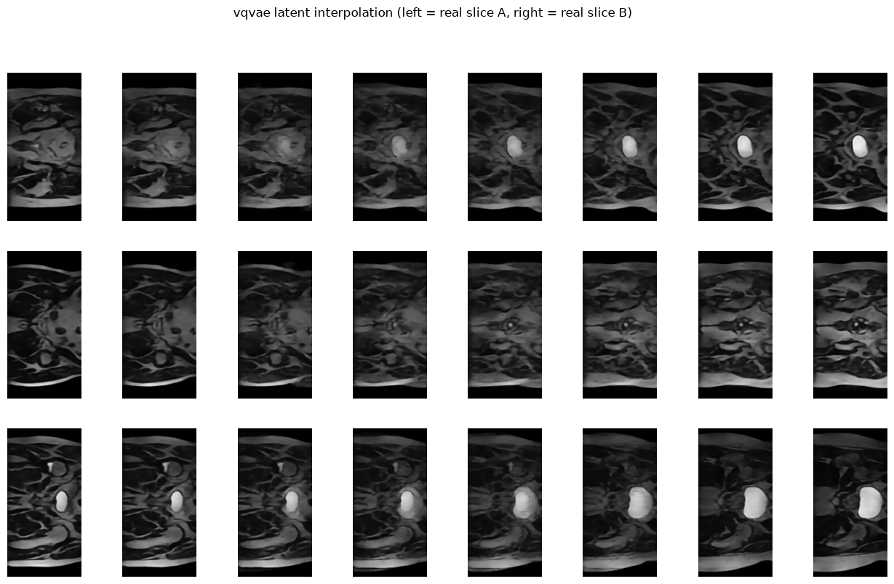


It can be seen that the base VAE does have a smoother transition between the 2 real samples, while the VQVAE seems to take discrete jumps. It can also be seen that the VAE produces a much blurrier image. I believe this is a result of the nature of the VQVAE, having a discrete codebook.   


**resource usage**
| model| VAE | VQVAE | VQVAE prior| 
|peak vram|0.85 GB |0.82 GB | 2.85 GB | 
| approx. time per epoch | 2.8 seconds | 3.0 seconds | 14.2 seconds| 

It can be seen that the VAE and VQVAE are relatively cheap to train, probably able to be done on a CPU if given a solid amount of time, the prior is more expensive and should be trained on a GPU. 

As for generation, the VAE generates images in 0.02 seconds vs the 8.3 to 8.6 seconds needed by the prior and VQVAE. While the VAE is cheaper in terms of image generation, it is significantly outpaced by the VQVAE in terms of image quality generation. 


**training curves**

Here are the generated training curves from the rangpur .out files 

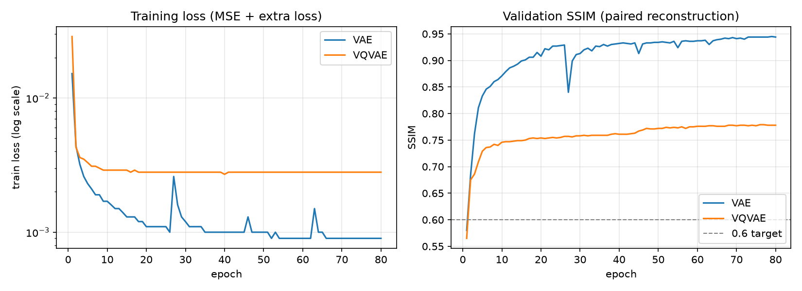

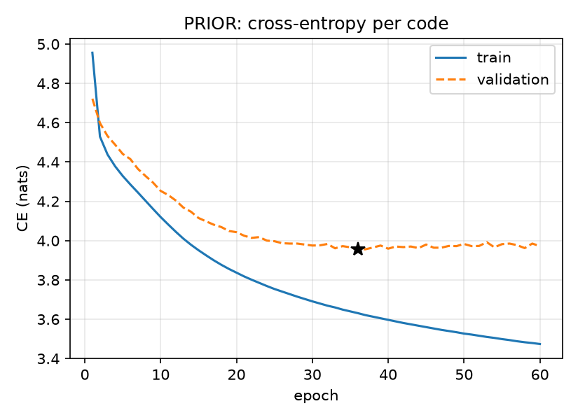


The final version of the VAE was trained locally, so the plot is the earlier cluster run (latent 64, weak beta, SSIM about 0.95), not the reported VAE (latent 8, test SSIM 0.447). It can be seen that the weak KL term meant the latent space didn’t match the N(0, 1) used for sampling, so sampled latents landed where the decoder had no training, even though reconstruction was excellent, and while it performs well in reconstruction, it is much too specific for generative purposes. 

The VQVAE plateaus at roughly 0.78 SSIM, well above the defined goal of 0.6.

Judging from the prior cross entropy training vs validation loss, the decision to increase the epoch count likely contributed to increased overfitting, as evident by the plateau in validation while training still goes down. That being said, the model is saved at lowest validation score rather than train score, (as seen on the marked star) so this avoids using just the most recent and lowest training loss settings.  

